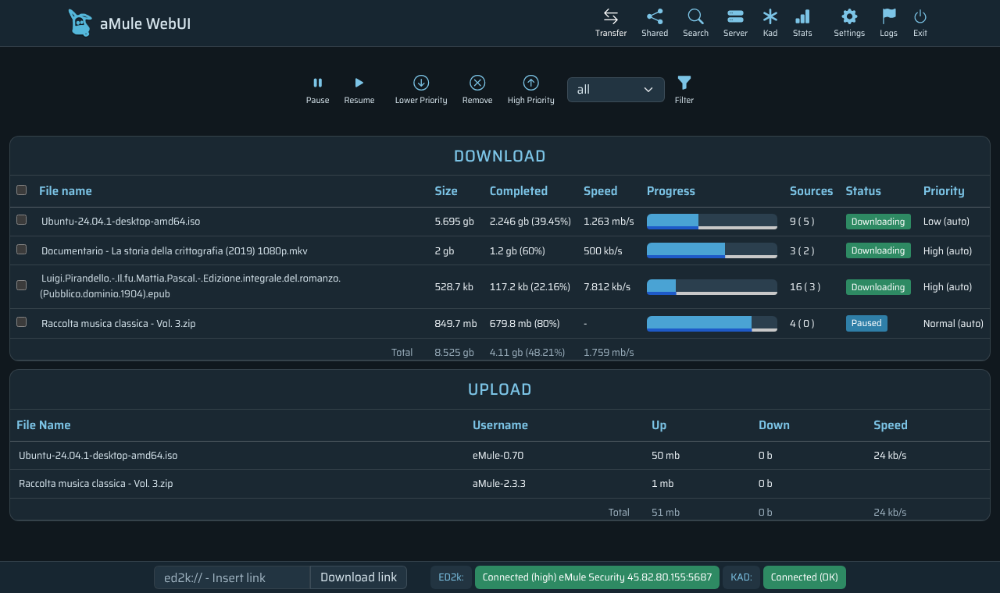
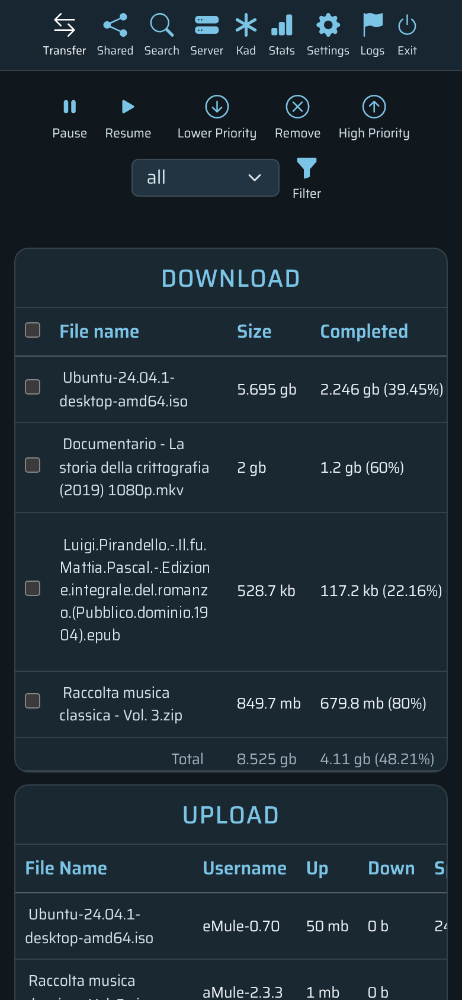
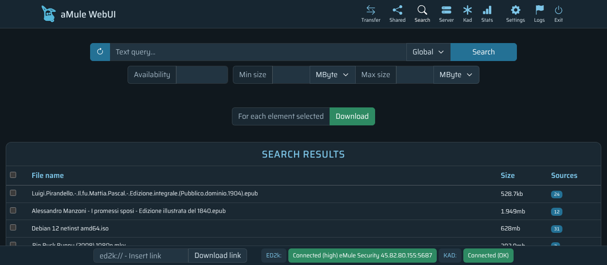
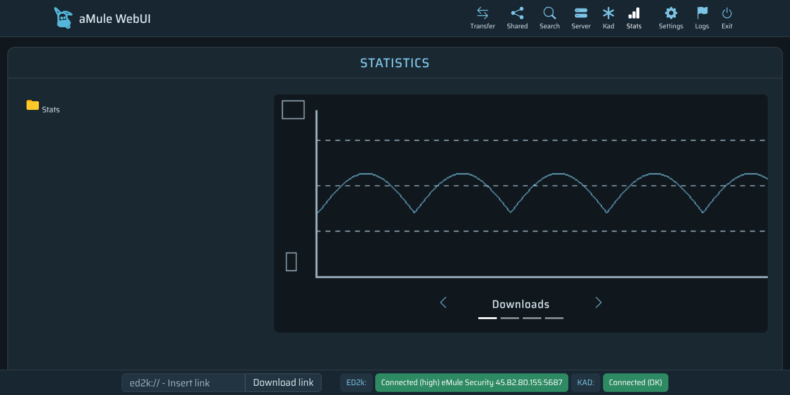
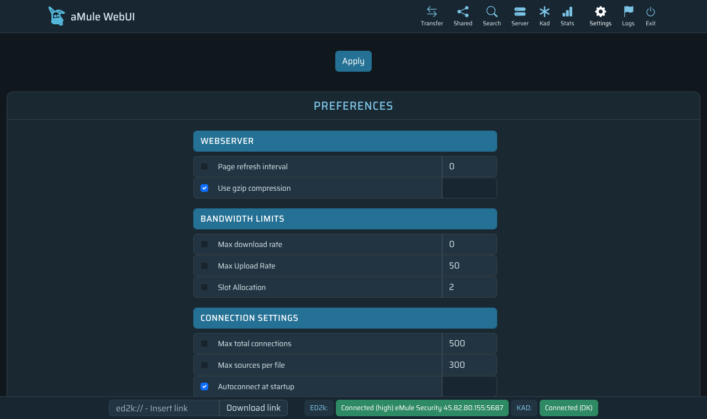
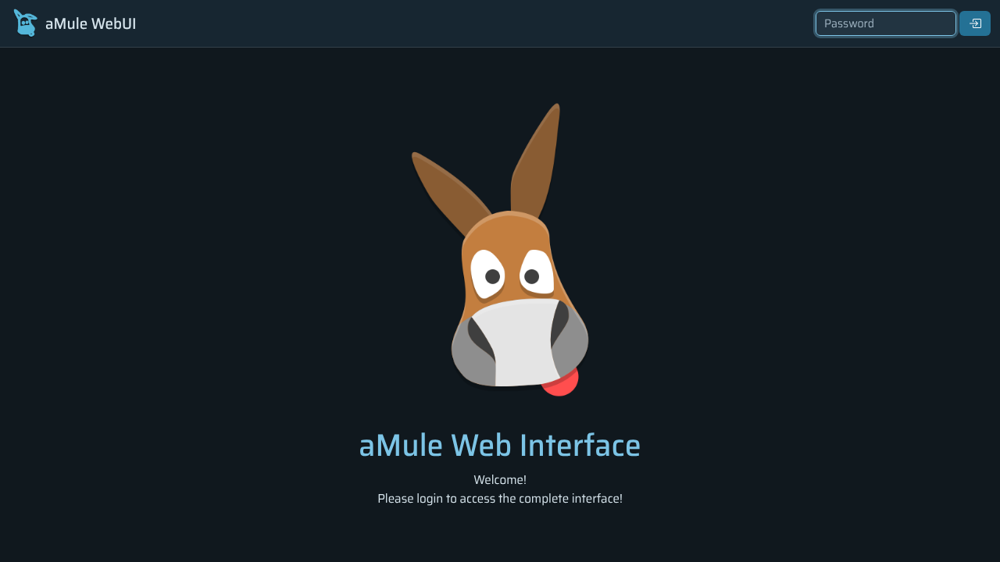

# AmuleWebUI-Reloaded — 2026 refresh

A modernised version of the **AmuleWebUI-Reloaded (Material)** web interface for the aMule daemon:
Bootstrap 5, a single stylesheet, a dark theme and a layout that works on phones.

> **This is a modified version** of [AmuleWebUI-Reloaded](https://github.com/MatteoRagni/AmuleWebUI-Reloaded)
> by Matteo Ragni and its contributors, revised by **Maurizio Imperatrice** in **October 2026**.
> Like the original, it is released under the **GNU General Public License v3** (see [LICENSE](LICENSE)).
> The full list of changes is in this repository's commit history.

| Transfers | Phone |
| --- | --- |
|  |  |

## What's new

- **Bootstrap 5.3** instead of Bootstrap 3, with no jQuery. All libraries are bundled with the theme,
  so nothing is loaded from the internet.
- **One stylesheet** (`amule.css`) replaces the styles that were copied into every page.
  All colours are CSS variables at the top of the file, so the palette can be changed in one place.
- **New dark palette** (slate blue with a light-blue accent) and the
  [Saira](https://github.com/Omnibus-Type/Saira) typeface throughout, slightly narrowed
  (93.75% width), with tabular figures so numbers line up in tables.
- **Works on phones**: one-row icon menu, tables that scroll sideways, a footer that wraps onto
  several lines and form fields that fit the screen.
- **Themed confirmation dialogs** instead of the browser's white pop-ups (download, remove, clear log).
- **Fixes**: a login page that is styled before you log in, a correctly aligned *Total* row
  in the download table, valid HTML (missing or extra tags closed), Bootstrap 5 carousel on the
  statistics page and a working "back to top" button on the search page.

The pages still do exactly what they did before: the PHP code that talks to aMule has not been
changed, only the HTML it prints.

## Screenshots

| Search | Statistics |
| --- | --- |
|  |  |

| Settings | Login |
| --- | --- |
|  |  |

The screenshots use sample data.

## Installation

Tested on a Raspberry Pi running Raspberry Pi OS.

1. Copy the theme into the aMule web server folder (the folder name is the template name):

   ```bash
   cd /usr/share/amule/webserver
   sudo git clone https://github.com/madaello/AmuleWebUI-Reloaded.git AmuleWebUI-New
   ```

   You can also download the ZIP from GitHub and extract it there.
   The files only need to be readable by aMule (`root:root`, folders `755`, files `644`).

2. Stop aMule, then set the template in `amule.conf` (for example `~/.aMule/amule.conf`
   of the user that runs aMule). aMule rewrites this file when it stops, so edit it while it is stopped:

   ```bash
   sudo systemctl stop amule-daemon
   sudo nano /home/USER/.aMule/amule.conf
   ```

   ```ini
   [WebServer]
   ...
   Template=AmuleWebUI-New
   ```

3. Start aMule again:

   ```bash
   sudo systemctl start amule-daemon
   ```

The interface is at `http://localhost:4711` (or the port set in `Port=` under `[WebServer]`).

### Good to know

- **Before you log in, amuleweb only serves images**: any other request, including `.css`
  and `.js` files, gets the login page. This is why `login.php` contains its own styles,
  and why the theme does not need the internet.
- amuleweb cannot serve font files, so the Saira font and the icons are embedded in `amule.css`.
- After an update, reload the page with **Ctrl+Shift+R** to skip the browser cache.

## Credits

Original project: **[Matteo Ragni](https://github.com/MatteoRagni/AmuleWebUI-Reloaded)**.

Contributors to the original project:

* Brax84 for a **full redesign** of the initial work ([Pull 17](https://github.com/MatteoRagni/AmuleWebUI-Reloaded/pull/17))
* Knocks83 for fixing README links ([Pull 18](https://github.com/MatteoRagni/AmuleWebUI-Reloaded/pull/18)) and minor fixes ([Pull 19](https://github.com/MatteoRagni/AmuleWebUI-Reloaded/pull/19))
* atlant2011 for integrity checks and browser caching ([Pull 14](https://github.com/MatteoRagni/AmuleWebUI-Reloaded/pull/14))
* gise88 for fixing an error in main search ([Pull 13](https://github.com/MatteoRagni/AmuleWebUI-Reloaded/pull/13))
* ThecaTTony for fixing an error in sort by files ([Pull 9](https://github.com/MatteoRagni/AmuleWebUI-Reloaded/pull/9))
* Daneden for [animate.css](https://github.com/daneden/animate.css/) (the two animations used are now plain CSS in `amule.css`)
* tetreum for fixes in CSS ([Pull 23](https://github.com/MatteoRagni/AmuleWebUI-Reloaded/pull/23)) and page refresh ([Pull 24](https://github.com/MatteoRagni/AmuleWebUI-Reloaded/pull/24))
* brunix86 for multiple selection, download confirmation and log fixes ([Pull 42](https://github.com/MatteoRagni/AmuleWebUI-Reloaded/pull/42))

2026 refresh: **Maurizio Imperatrice**.

Third-party components bundled with the theme (Bootstrap, Popper, Bootstrap Icons, Saira) keep their own
licences: see [THIRD-PARTY-NOTICES.md](THIRD-PARTY-NOTICES.md).

Screenshots of the earlier versions are kept in [doc-images/ReloadPic](doc-images/ReloadPic)
and [doc-images/ReloadMateriaPic](doc-images/ReloadMateriaPic).
